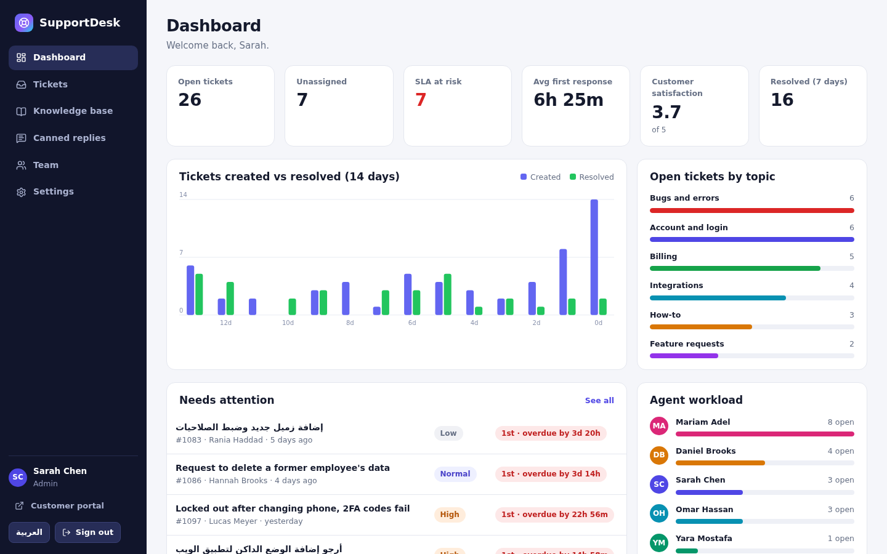
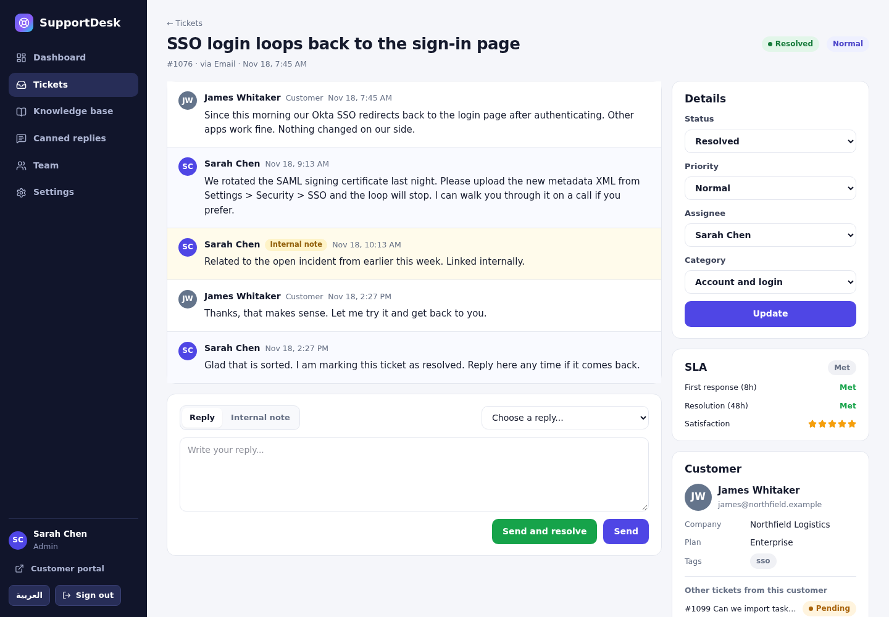
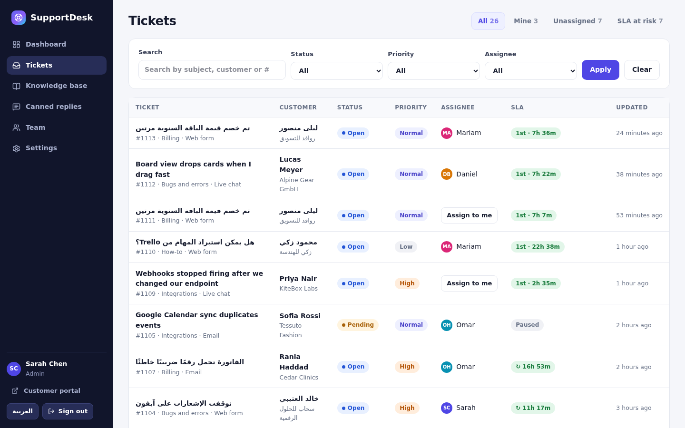
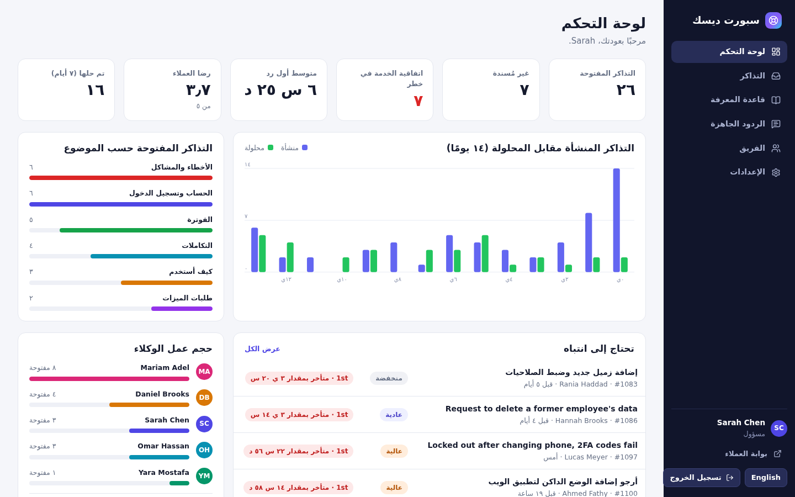
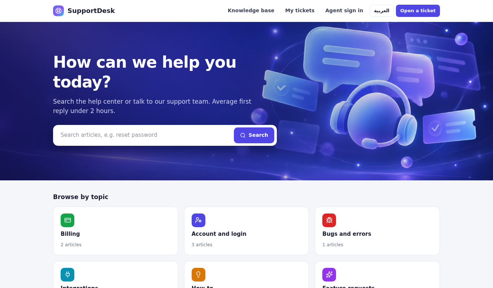
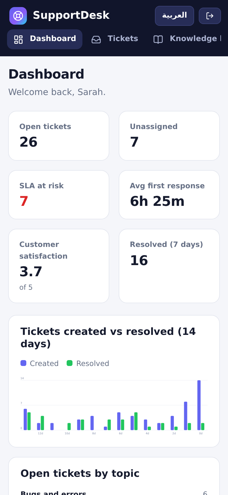
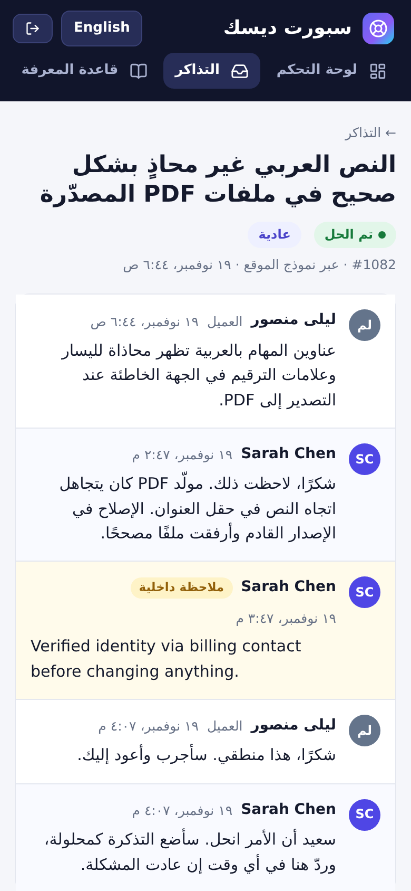

# SupportDesk

**Bilingual helpdesk and customer support platform: ticket inbox with SLA timers, knowledge base, canned replies and a customer portal.**
Next.js 16 (App Router) · React 19 · TypeScript · Prisma · Tailwind CSS 4
English + Arabic (full RTL) UI.

> **Attribution:** This project was built by an AI assistant (Instinct) under the
> direction of **Nada Gamal**. Scope, product decisions, review and acceptance are
> hers; the code is AI-assisted, not hand-written by her. It is a **portfolio demo**:
> seeded data only, and no email, chat or payment provider is connected. Nothing is
> sent anywhere.



## What it does

**For agents (`/app`)**

- **Dashboard**: open and unassigned tickets, SLA-at-risk count, average first response time, customer satisfaction (CSAT), 14-day created vs resolved chart, open tickets by topic, agent workload, and a "needs attention" list sorted by SLA urgency.
- **Ticket inbox**: views for All, Mine, Unassigned and SLA at risk, plus filters (status, priority, assignee) and search by subject, customer or ticket number.
- **Ticket workspace**: full conversation thread, public replies and internal notes, canned-reply picker with `{{customer}}` and `{{agent}}` placeholders, "send and resolve", assignment, status, priority and category changes, SLA panel with first-response and resolution timers, and the customer's other tickets.
- **SLA engine**: targets per priority (Urgent 1h/4h, High 4h/24h, Normal 8h/48h, Low 24h/72h for first response/resolution). A ticket turns amber with 25% of its time left and red when overdue. Tickets waiting on the customer or on hold pause the resolution clock. Changing priority recalculates the due dates.
- **Knowledge base editor** (admins): bilingual articles with categories, publish/draft, views and helpfulness stats.
- **Canned replies** (admins): bilingual reply templates.
- **Team**: workload, resolved count, average first response and average rating per agent.
- **Roles**: Admin and Agent. Only admins manage the knowledge base and canned replies.

**For customers (`/`, `/help`, `/portal`)**

- Help center with search, topic browsing, bilingual articles and "was this helpful?" voting.
- Customer portal: open a ticket, track it, reply, and rate the support when it is resolved. A customer only sees their own tickets and never sees internal notes.

**Internationalization**: every screen exists in English and Arabic with proper RTL layout, Arabic-Indic numerals and localized dates and durations. Ticket content keeps its own direction, so an Arabic ticket reads correctly inside the English UI and the other way round.

## Screenshots

| | |
|---|---|
| Ticket workspace |  |
| Ticket inbox |  |
| Arabic RTL dashboard |  |
| Customer help center |  |
| Mobile (390px) |   |

## Run it

```bash
npm install          # also runs prisma generate
npm run db:push      # creates the SQLite demo database (dev.db)
npm run db:seed      # seeds 5 agents, 14 customers, 72 tickets, 10 articles, canned replies
npm run dev          # http://localhost:3000
```

Pick any agent on `/login` (no passwords in the demo; role-based behavior still applies). Sign in as **Sarah Chen (Admin)** to edit the knowledge base. Customers can be chosen on `/portal`, or just open a new ticket from the help center.

## Architecture

```
src/
  app/
    (public)/           landing, help center, customer portal
    login/              demo agent sign-in
    app/                dashboard, tickets, ticket workspace, knowledge base, canned, team, settings
    api/act/            one POST endpoint, dispatches form actions by intent
  components/           sidebar, badges, reply box, avatar, language toggle
  lib/                  prisma client, SLA engine, i18n dictionaries (en/ar), formatting, session
prisma/
  schema.prisma         agents, customers, categories, tickets, messages, canned replies, articles
  seed.ts               deterministic demo data (seed-data.ts holds the bilingual content)
```

## Honest limits

This is a demo, not a production helpdesk. Compared with Zendesk, Freshdesk or Help Scout it does **not** have:

- Real email or chat channels (there is no inbound email parsing and no outbound mail)
- Production authentication, SSO, audit logs, or per-field permissions
- Business-hours calendars for SLA (the clock runs 24/7), escalation rules or automations
- Attachments, a rich-text editor, merge or split tickets, macros with actions
- Reporting beyond the dashboard and team pages

The demo login is role selection, not authentication. All names, companies and ticket content are fictional. "Nimbus Cloud" is an invented product used to make the support content realistic.

## Hosted demo

Live demo: https://supportdesk-orpin-mu.vercel.app (sign in as any demo agent on `/login`). It runs on seeded data and is **read-only**: serverless hosting gives every route its own temporary copy of the demo database, so a ticket created on one page would not be visible on the next. Browsing, filtering, search, language switching and role-based views all work. To create tickets, reply, assign and edit the knowledge base, run it locally (steps above). The seeded timestamps are shifted on startup so the dashboard always looks current. A production deployment would point Prisma at Postgres.
